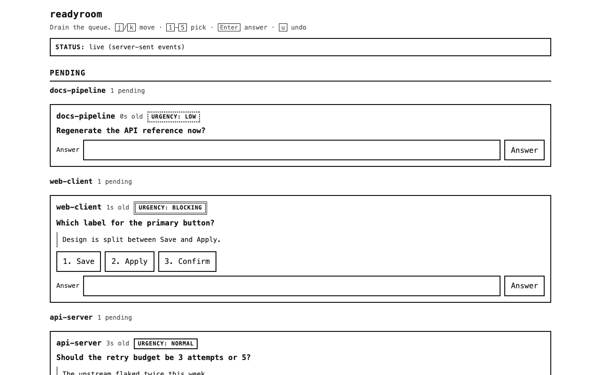
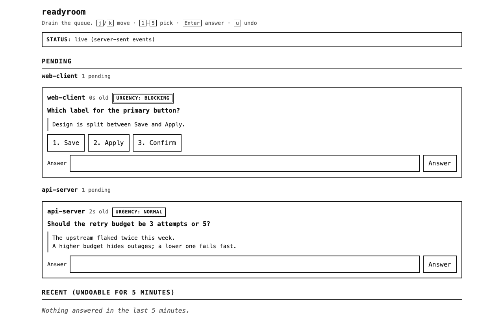
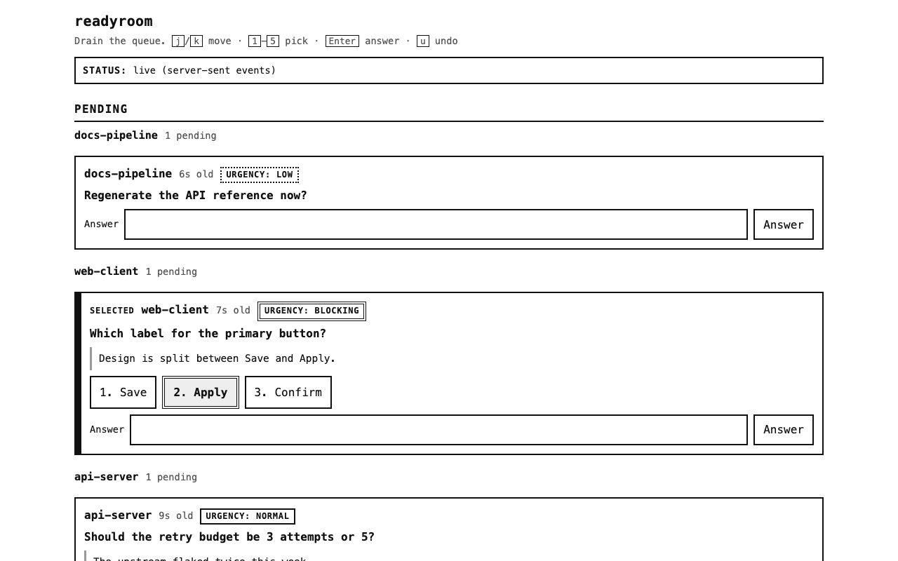
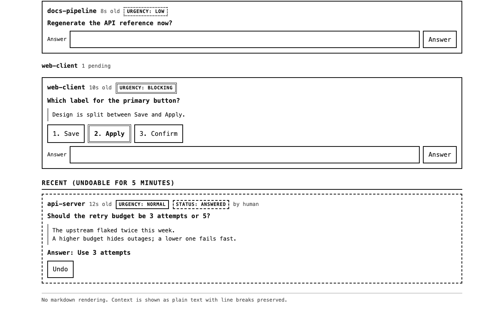
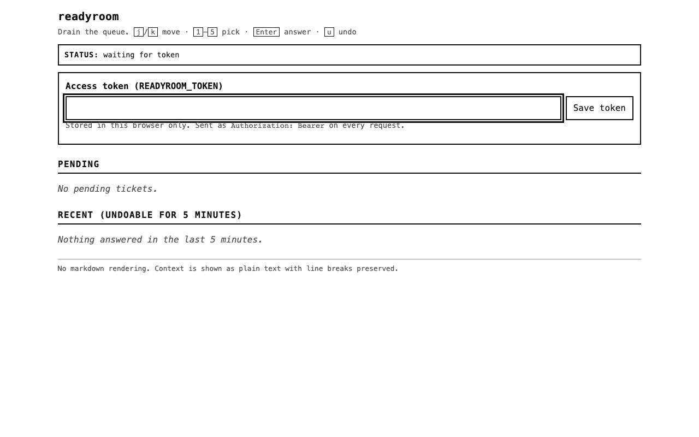
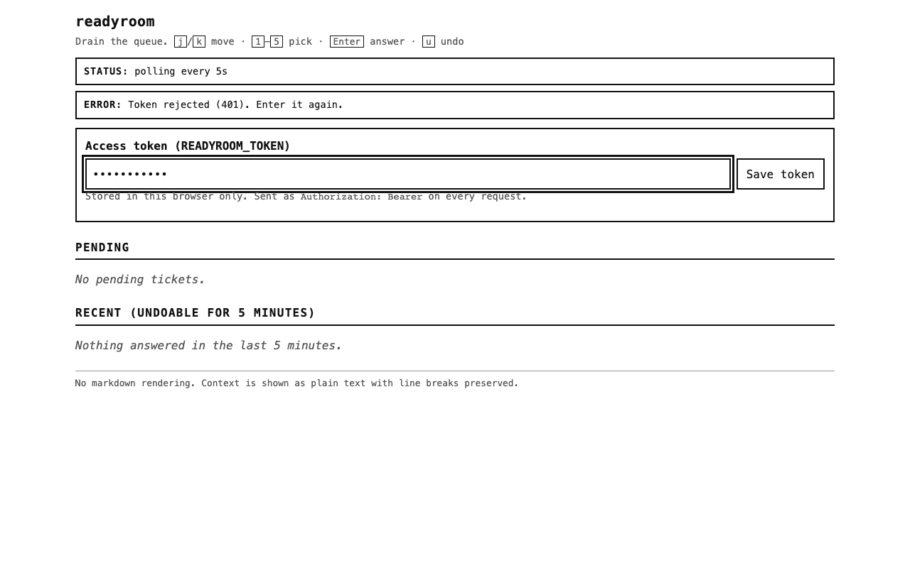
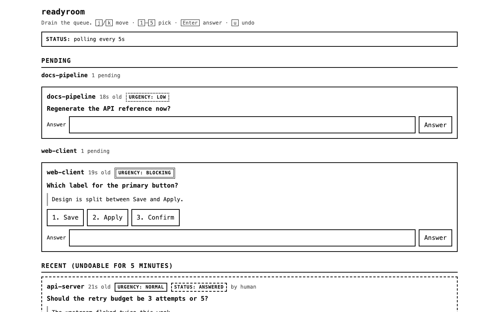
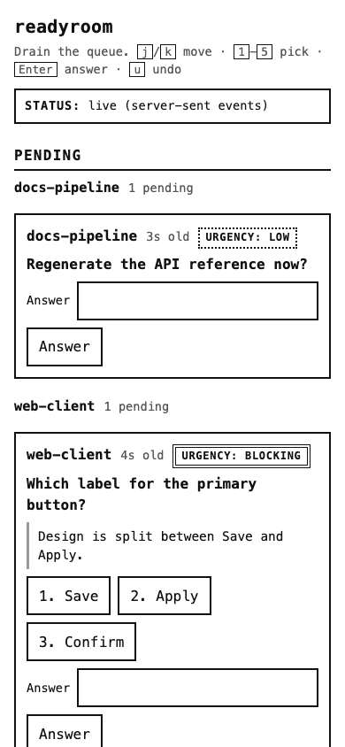

<p align="center">
  <a href="https://www.npmjs.com/package/readyroom"></a>
  
  
  
</p>

# readyroom

**The bridge runs the ship. The ready room decides.**

> [!WARNING]
> readyroom is under active development. Don't rely on it for anything that matters until v1.

## What is this?

An agent that reaches a decision it should not make alone has two bad options today. It can
guess, and the guess becomes fact downstream. Or it can stop and wait, which holds its session
open until a human notices, and usually surfaces as a modal that hijacks whatever you were
doing.

readyroom gives it a third. The agent writes a **ticket** — one question, optional choices,
minimal context — and goes back to work. You drain the tickets from one page when you get to
them. The page groups them under the agent that asked, so you always know who is waiting on
you, and the agent collects the answer the next time it asks.

The name is the design. On a ship, the bridge is where the work happens and the **ready room**
is where the captain steps away to decide something that should not be decided in the noise.
The whole invariant is **N agents, one interrupt channel**: however many agents you run, they
share one place to ask and one place for you to answer.

## Why readyroom

- **No agent ever blocks.** `ask_human` enqueues a ticket and returns in under 200 ms. A
  blocking tool holds the MCP session open and wedges the client the moment you step away
  from the keyboard for twenty minutes.
- **The queue survives a restart.** Tickets are written atomically to disk, or to a single
  Durable Object on the Worker. A restart that forgot pending tickets would mean an agent
  waiting forever on a question nobody can see any more.
- **You know which agent is asking.** Tickets are grouped by **stream** — the agent that
  asked — with the newest stream first. A flat list of questions from four agents is not a
  queue you can drain; it is a pile.
- **It never takes over your screen.** There is no modal and no focus stealing. The page is a
  **status board, not a chat log**: it shows what is waiting and clears when you have answered.
- **Draining is keyboard-first.** `j`/`k` to move, `1`-`5` to pick an option, `Enter` to
  submit, `u` to undo. A queue with only a mouse is the slow path, and the point of a queue is
  that it drains quickly.
- **The log is append-only and never pruned.** An approval log is the only record that a human
  authorised something, so it is kept in full. That is what a log is.
- **Three ways to run it, one program.** `npx` for one machine, Docker for an always-on box,
  a Cloudflare Worker for when your agents cannot reach either.

## Screenshots

The page is one flow — the human draining the queue — and one authenticated role, so every
capture is a *state* of that single flow rather than a role of its own. A few representative
moments, desktop first:

<table>
<tr>
<td align="center"><b>Queue, grouped by stream</b></td>
<td align="center"><b>Options and free text</b></td>
<td align="center"><b>Option selected</b></td>
<td align="center"><b>Recent (undoable 5 min)</b></td>
</tr>
<tr>
<td></td>
<td></td>
<td></td>
<td></td>
</tr>
</table>

<table>
<tr>
<td align="center"><b>Token gate</b></td>
<td align="center"><b>Token rejected (401)</b></td>
<td align="center"><b>Polling fallback</b></td>
<td align="center"><b>Phone width</b></td>
</tr>
<tr>
<td></td>
<td></td>
<td></td>
<td></td>
</tr>
</table>

There is also an empty board, an inline per-card validation error, and a failed-load banner —
the page is captured at `1280x800` (desktop) and `390x844` (the two `mobile-*` shots). A full set
of every screen and state, with a one-line description of each, is in
[`docs/screenshots/MANIFEST.md`](docs/screenshots/MANIFEST.md) — regenerate the lot with

```sh
npm run screenshots
```

which starts its own isolated readyroom on `:8972`, drives each state, and tears it down. For how
to actually use each of these screens, see [`docs/USAGE.md`](docs/USAGE.md).

## Vocabulary

These words are used exactly, in code, comments, tool descriptions, and docs. No synonyms.

- **ticket** — one pending request: `{ id, stream, question, options, context, urgency, status, created_at, expires_at }`.
- **stream** — which agent asked. Defaults to `$READYROOM_STREAM`, else `basename(cwd)`.
- **drain** — the human answering tickets from the page.
- **readyroom page** — the single HTML page served at `GET /`.

The tool names (`ask_human`, `wait_for_answer`, `list_pending`, `cancel_ticket`) are the
agent-facing contract and do not change with the product name. The product name is a separate
layer, the way `ripgrep` ships `rg`.

## The one rule that matters

**`ask_human` enqueues and returns. It never waits.**

A blocking tool holds the MCP session open and wedges the client when the human is heads-down
for twenty minutes. Enqueue-then-poll keeps the transport healthy. `ask_human` returns
`{ id, status: "pending" }` in under 200 ms.

This rule is also what makes the Worker target possible at all. A Workers invocation cannot
hold a session open for twenty minutes; a request that enqueues and returns is stateless enough
to run per-request on the edge. There is no blocking variant on any target.

The `ask_human` tool description is where the agent learns the protocol: *on `pending`,
continue with independent work and call `wait_for_answer` again later; do not poll in a tight
loop.*

## The four MCP tools

All four tools are identical across all three targets. Only the transport differs.

### `ask_human`

Enqueues a ticket and returns immediately.

```ts
ask_human({
  question: string,           // required. One sentence. What must be decided.
  options?: string[],         // optional. 2-5 mutually exclusive choices.
  context?: string,           // optional. Minimal text needed to decide. Plain text.
  default_answer?: string,    // optional. Used only if the ticket expires. Set it only
                              // when it is safe for the agent to proceed without a human.
  timeout_seconds?: number,   // optional. Default 1800. Max 86400.
  urgency?: "low" | "normal" | "blocking",  // optional. Default "normal".
  stream?: string             // optional. Overrides the env/basename default.
}) => { id: string, status: "pending", expires_at: string }
```

### `wait_for_answer`

Waits for the human to answer, then returns the result. Returns immediately if the ticket is
already answered or expired.

```ts
wait_for_answer({
  id: string,
  timeout_seconds?: number    // default 60, max 600
}) => {
  id: string,
  status: "pending" | "answered" | "expired",
  answer?: string,
  answered_by?: string,       // "human" | "default"
  answered_at?: string
}
```

### `list_pending`

Lists the tickets still pending across every agent stream. Takes no arguments.

```ts
list_pending({}) => { tickets: Ticket[] }
```

### `cancel_ticket`

Cancels a ticket the agent no longer needs answered.

```ts
cancel_ticket({ id: string }) => { id: string, status: "cancelled" }
```

### The `HUMAN ANSWER:` prefix

A delivered human answer is prefixed with `HUMAN ANSWER:` so a model can never confuse it with
its own earlier guess. An answer that came from `default_answer` gets a clearly different
prefix — `DEFAULT ANSWER (applied on expiry; no human responded):` — because labelling the
agent's own default as a human answer would be worse than no prefix at all.

## Three ways aboard

They run the same program. They differ in where it lives and who can reach it.

| | `npx` | Docker from GHCR | Cloudflare Worker |
|---|---|---|---|
| setup | `npx readyroom` | pull `ghcr.io/therebelrobot/readyroom` | `wrangler deploy` |
| runs | on the host, as you | in a container, as a non-root user | on the edge, with no box to patch |
| state | `./.state` on disk | a volume mount | one SQLite Durable Object |
| reachable from | loopback only, by default | loopback; your LAN through a reverse proxy | anywhere, behind Cloudflare Access |
| MCP transport | stdio + Streamable HTTP | stdio + Streamable HTTP | Streamable HTTP |
| live updates | SSE | SSE | polling; the page falls back on its own |
| best for | trying it in a minute | always-on, arm64, survives reboots | agents that cannot reach your house |

### npx — one developer, one machine, thirty seconds

```sh
npx readyroom
```

No config, no container, no account. The server speaks stdio MCP (wire it into your MCP client)
and also serves Streamable HTTP on the same process for clients that want it.

**The singleton.** Three MCP clients spawning `npx readyroom` would otherwise produce three
processes, three attempts to bind port 8971, and three writers to one `tickets.json` — which
breaks the single-writer invariant and can corrupt the queue. So:

- The **first** process to start becomes the **daemon**: it binds the port, owns the store, and
  writes `${READYROOM_STATE_DIR}/daemon.json` containing `{ pid, port, started_at }`.
- Every **subsequent** process becomes a **client**: it reads `daemon.json`, confirms the pid is
  alive and `/healthz` answers, then proxies its MCP tool calls to the daemon over
  `http://127.0.0.1:<port>`. It serves stdio on its own file descriptors and nothing else. It
  never writes `tickets.json`.

If `daemon.json` is stale (pid dead, or the port refuses), the starting process acquires the
daemon role itself and overwrites the file. If the daemon is unreachable but a foreign service
holds the port, the process **refuses to start** with a message naming the port — it never
silently falls back to a second writer.

### Self-hosted Docker on a Raspberry Pi

Always-on, arm64, LAN-reachable, survives reboots. The image is multi-arch
(`linux/amd64,linux/arm64`); arm64 is required because the deploy target is a Pi.

```sh
docker run --rm -d \
  -p 127.0.0.1:8971:8971 \
  -v "$(pwd)/.state:/app/.state" \
  --env-file .env \
  ghcr.io/therebelrobot/readyroom:latest
```

Or as a mergeable compose snippet. It binds to loopback; LAN exposure goes through the reverse
proxy.

```yaml
services:
  readyroom:
    image: ghcr.io/therebelrobot/readyroom:latest
    container_name: readyroom
    restart: unless-stopped
    stdin_open: true
    ports:
      - "127.0.0.1:8971:8971"
    environment:
      READYROOM_TOKEN: ${READYROOM_TOKEN:?set READYROOM_TOKEN}
      READYROOM_STATE_DIR: /app/.state
      READYROOM_BIND: 0.0.0.0
    volumes:
      - ./readyroom-state:/app/.state
```

Copy this file to get a runnable setup without retyping it:
[`examples/docker-compose.yml`](examples/docker-compose.yml) — set `READYROOM_TOKEN`, then
`docker compose up -d`.

The container runs the same Node entry as npx, in stdio-plus-HTTP mode, as a non-root user, and
handles `SIGTERM`.

> [!NOTE]
> **GHCR packages start private.** After the first publish run, flip the package to public in
> the GitHub package settings, or `docker pull` will fail with an authentication error.

### Cloudflare Worker

Always-on, reachable from anywhere, no box to patch. The Worker serves the readyroom page and
the Streamable HTTP MCP endpoint from the same origin, backed by one SQLite Durable Object
instance.

```sh
# 1. Supply the token as a secret (never committed).
wrangler secret put READYROOM_TOKEN

# 2. Deploy.
npm run deploy:worker
```

The MCP endpoint is per-agent: **`POST /mcp/{stream}`**. Each agent gets its own URL, configured
once in the client. There is no `cwd` on Workers, so `basename(cwd)` cannot be the fallback —
the stream is required and comes from the path segment or an explicit `stream` tool argument.
If neither is present, the tool call fails with an error naming both ways to supply it. No
default is invented.

## MCP Configuration

An MCP client reaches readyroom over one of two transports. How you run the server decides
which one is available.

### Entry points

| Command | Target | Transports | State |
|---|---|---|---|
| `npx readyroom` | Node, on the host | stdio + Streamable HTTP | `./.state` on disk |
| `npm start` (`node dist/server.mjs`) | Node, built bundle | stdio + Streamable HTTP | `./.state` on disk |
| `npm run dev` (`tsx watch --import ./scripts/html-loader-register.mjs src/index.ts`) | Node, development | stdio + Streamable HTTP | `./.state` on disk |
| `docker run … ghcr.io/therebelrobot/readyroom:latest` | Docker | stdio + Streamable HTTP | volume mount |
| `npm run dev:worker` (`wrangler dev`) | Cloudflare Worker, local | Streamable HTTP only | Durable Object |
| `npm run deploy:worker` (`wrangler deploy`) | Cloudflare Worker, edge | Streamable HTTP only | Durable Object |

On the Node targets a process resolves into a **daemon** or a **client** (see
[the singleton](#three-ways-aboard)): the first process becomes the daemon and serves both
transports on the port; later processes join as clients and serve stdio only, proxying their
tool calls to the daemon. The role is decided at start — there is nothing to configure.

### Transports

- **stdio** — Node targets only. The MCP client spawns the process and speaks the protocol over
  its file descriptors. The server writes nothing to stdout but MCP frames; all logs go to
  stderr. Select it by configuring the client to run a `command`.
- **Streamable HTTP** — every target. On Node the daemon mounts it at `POST /mcp` (methods
  `GET`, `POST`, `DELETE`) on the same port. On the Worker it is the only transport, mounted at
  `/mcp` (stream supplied as the `/mcp/{stream}` path segment). Select it by pointing the client at the URL.

The two are not exclusive on Node: one daemon serves stdio and HTTP at once, so one agent can
run over stdio and another over HTTP against the same queue.

#### The `/mcp` endpoint is Origin-guarded

Both HTTP mounts reject a request whose `Origin` header is missing or not on the allowlist,
with `403`. On Node the allowlist is built from the server's own origins — `http://127.0.0.1:<port>`
and `http://localhost:<port>` — plus any `READYROOM_ALLOWED_ORIGINS` entries. On the Worker it
is the Worker's own origin plus the same extras. See `src/security.ts`.

> [!NOTE]
> An HTTP MCP client must send an `Origin` header that matches the allowlist. A client that
> sends no `Origin` at all is rejected. If your client sends a different origin (or none), add
> it to `READYROOM_ALLOWED_ORIGINS`.

#### Streams over HTTP

On Node the stream defaults to `READYROOM_STREAM`, else `basename(cwd)`, and can be overridden
per call with the `stream` tool argument. On the Worker there is no `cwd`: the stream comes from
the `POST /mcp/{stream}` path segment, or an explicit `stream` argument. If neither is present,
the call fails with an error naming both ways to supply it.

### Configuration options

All six are read from the process environment on the Node targets, and, on the Worker, only
`READYROOM_TOKEN` and `READYROOM_ALLOWED_ORIGINS` are read from `[vars]` / `secrets` in
`wrangler.toml`. `src/config.ts` is the single source of truth.

| Variable | Default | Required? | Meaning |
|---|---|---|---|
| `READYROOM_STREAM` | `basename(cwd)` | optional | Default stream for tickets. Overridable per call via the `stream` tool argument. Not applicable on the Worker. |
| `READYROOM_TOKEN` | *(unset)* | **mandatory on Docker and the Worker**, optional on Node | Shared secret for `/api/*` and the Node `/internal/tool-call` proxy. |
| `READYROOM_BIND` | `127.0.0.1` | optional | Bind address. A non-loopback value refuses to start unless `READYROOM_TOKEN` is set. Not applicable on the Worker. |
| `READYROOM_STATE_DIR` | `./.state` | optional | Directory holding `tickets.json`, `audit.jsonl`, and `daemon.json`. Not applicable on the Worker. |
| `READYROOM_PORT` | `8971` | optional | TCP port. Must not collide with 3000-3899, which a worktree helper allocates. Not applicable on the Worker. |
| `READYROOM_ALLOWED_ORIGINS` | *(unset)* | optional | Comma-separated extra origins allowed on the `/mcp` Origin guard, appended to the server's own origin. |

The per-target Worker mapping is in [Environment variables](#environment-variables).

### MCP client configuration

#### stdio (Claude Desktop and other MCP clients)

```json
{
  "mcpServers": {
    "readyroom": {
      "command": "npx",
      "args": ["-y", "readyroom"],
      "env": {
        "READYROOM_STREAM": "my-agent",
        "READYROOM_STATE_DIR": "/home/you/.readyroom"
      }
    }
  }
}
```

Every client that spawns readyroom becomes the daemon or a client automatically; you do not set
the role. Give each agent its own stream with `READYROOM_STREAM` (or the `stream` argument to
`ask_human`). If any process in a shared daemon group sets `READYROOM_TOKEN`, every process in
that group must set the same value — the client forwards it to the daemon.

For a built or installed copy, replace `command` with the absolute path to `dist/server.mjs`
(or the `readyroom` binary on `PATH`).

#### Streamable HTTP (Node daemon)

```json
{
  "mcpServers": {
    "readyroom": {
      "url": "http://127.0.0.1:8971/mcp",
      "headers": {
        "Origin": "http://127.0.0.1:8971"
      }
    }
  }
}
```

#### Streamable HTTP (Cloudflare Worker)

The stream is the path segment, so each agent gets its own URL.

```json
{
  "mcpServers": {
    "readyroom": {
      "url": "https://readyroom.example.com/mcp/my-agent",
      "headers": {
        "Origin": "https://readyroom.example.com"
      }
    }
  }
}
```

### Directing an agent to use readyroom (`AGENTS.md`)

Paste the block below into your project's `AGENTS.md` (or `CLAUDE.md`) so the agent knows
readyroom is available and how to reach it. It goes at the top level of that file, alongside
your other project instructions.

````markdown
## Asking a human

When you reach a decision you cannot make alone — a choice with real consequences, a
preference only the operator holds, or anything you would otherwise guess at — ask the
operator through the `readyroom` MCP server instead of guessing or blocking.

- `ask_human` — enqueue a question and return immediately. It never waits. Pass `question`
  (one sentence), and optionally `options` (2-5 mutually exclusive choices), `context`,
  `default_answer`, `timeout_seconds`, `urgency`, and `stream`. It returns
  `{ id, status: "pending" }`.
- `wait_for_answer` — block for the human's answer to a ticket you enqueued. Pass the `id`.
  It returns immediately if the ticket is already answered or expired; if it is still
  pending, continue with independent work and call it again later. Do not poll in a tight loop.
- `list_pending` — list the tickets still pending across every agent stream. Takes no arguments.
- `cancel_ticket` — withdraw a ticket you no longer need answered. Pass the `id`.

A delivered human answer is prefixed with `HUMAN ANSWER:`. An answer applied from
`default_answer` on expiry is prefixed `DEFAULT ANSWER (applied on expiry; no human
responded):` — never treat that as a human answer.
````

### Auth and secrets

`src/security.ts` holds both guards.

- **`READYROOM_TOKEN`** protects `/api/*` (the page's API) and, on Node, the `/internal/tool-call`
  proxy between a client process and its daemon. The comparison is constant-time via the shared
  `src/core/constantTimeEqual.ts`, so Node and the Worker get the identical guarantee.
- **The `/mcp` MCP endpoint is guarded by the `Origin` header, not by the token.** A missing or
  mismatched `Origin` is rejected with `403`; the MCP specification requires this of HTTP
  transports. `READYROOM_ALLOWED_ORIGINS` extends that allowlist.
- On Docker and the Worker the token is **mandatory**. On Node it is optional for a loopback
  bind and mandatory for any non-loopback bind — the refusal rule in `src/config.ts` enforces it.

> [!NOTE]
> `src/config.ts` and the [Environment variables](#environment-variables) table describe
> `READYROOM_TOKEN` as the secret for "the MCP endpoint". In the shipped code the token is
> enforced on `/api/*` (and the Node `/internal/tool-call` proxy) only; the `/mcp` endpoint is
> authenticated by its `Origin` guard instead. This section documents the code's actual behavior.

##### A note on secrets

Treat `READYROOM_TOKEN` as a bearer secret. On the Worker, set it with
`wrangler secret put READYROOM_TOKEN` and never commit it. On Docker and npx, supply it through
an `--env-file` or your process manager, not a shell history. Never expose the server to a
public network directly — see [Never expose this to a public network directly](#never-expose-this-to-a-public-network-directly).

## Environment variables

Five variables, plus one optional extra.

| Variable | Default | Meaning |
|---|---|---|
| `READYROOM_STREAM` | `basename(cwd)` | Default stream for tickets. Overridable per call via the `stream` tool argument. |
| `READYROOM_TOKEN` | *(unset)* | Shared secret for `/api/*` and the MCP endpoint. Mandatory on Docker and Worker; optional on npx (loopback-only). |
| `READYROOM_BIND` | `127.0.0.1` | Bind address. A non-loopback value refuses to start unless `READYROOM_TOKEN` is set. |
| `READYROOM_STATE_DIR` | `./.state` | Directory holding `tickets.json`, `audit.jsonl`, and `daemon.json`. |
| `READYROOM_PORT` | `8971` | TCP port. Must not collide with 3000-3899, which a worktree helper allocates. |
| `READYROOM_ALLOWED_ORIGINS` | *(unset)* | Optional. Comma-separated extra origins allowed on the `/mcp` Origin guard, appended to the server's own origin. |

### Mapping to the Worker

On the Worker these are **`vars` and `secrets` in the Wrangler config, not process
environment**. The mapping is explicit:

| Node env var | Worker equivalent |
|---|---|
| `READYROOM_TOKEN` | **Secret.** `wrangler secret put READYROOM_TOKEN`. Never committed. |
| `READYROOM_ALLOWED_ORIGINS` | `[vars]` in `wrangler.toml` (optional). |
| `READYROOM_STREAM` | Not applicable — the stream comes from the `POST /mcp/{stream}` path. |
| `READYROOM_BIND` | Not applicable — there is no bind address on Workers. |
| `READYROOM_STATE_DIR` | Not applicable — there is no state dir; the Durable Object owns the state. |
| `READYROOM_PORT` | Not applicable — the Worker is addressed by URL. |

## The loopback bind rule, per target

An approval endpoint is a privilege-escalation surface — whoever can answer a ticket can grant
an agent permission to act. The bind rule exists for that reason.

- **npx** — binds `127.0.0.1` by default. `READYROOM_BIND` may override, but when it is
  anything other than a loopback address the server **refuses to start** unless
  `READYROOM_TOKEN` is set. With no token configured, `/api/*` is reachable only on loopback,
  where the OS is the access control.
- **Docker** — the container binds `0.0.0.0` internally and the port is mapped to `127.0.0.1`
  on the host. The process therefore *always* sees a non-loopback bind, so the token is
  mandatory and the refusal rule always applies. **The loopback guarantee comes from the port
  mapping, not from the process.**
- **Worker** — there is no loopback and no safe fallback configuration. The token is mandatory,
  the refusal rule has no analogue, and the service is public by construction. This is not
  pretended otherwise.

## Who has the conn

Whoever can answer a ticket can grant an agent permission to act. Three rules follow.

1. **Every `/api/*` route requires `Authorization: Bearer $READYROOM_TOKEN`,** compared in
   constant time. The comparison is a shared `constantTimeEqual(a, b)` that compares digests
   byte by byte with no early return — `node:crypto.timingSafeEqual` is a Node builtin and is
   not reliably present on Workers, so one shared implementation is the only way all three
   targets get the same guarantee.
2. **The page collects the token once and stores it in `localStorage`,** attaching it to every
   request. A `401` drops the stored token and re-prompts.
3. **The Streamable HTTP MCP endpoint rejects a missing or mismatched `Origin` with `403`.**
   The MCP specification requires this of HTTP transports, and it is the reason the SDK ships
   host and origin validation guards. It is the browser-side guard against a malicious page in
   the same browser POSTing to the local MCP endpoint (DNS rebinding / cross-origin).

The reason for all three: an approval endpoint is a privilege-escalation surface.

### Never expose this to a public network directly

- **LAN access goes through the existing reverse proxy with its own auth in front.** The
  container (or npx process) binds loopback; the reverse proxy terminates TLS, enforces its own
  authentication, and forwards to `127.0.0.1:8971`. The proxy is the only thing on the LAN that
  can reach the port.
- **Worker deployments should sit behind Cloudflare Access.** The Worker is public by
  construction; Cloudflare Access is the layer that keeps it from being reachable by anyone
  with the URL.

Topology:

```
agent (MCP client) ──stdio──▶ readyroom (loopback :8971)
                                    ▲
human browser ──HTTPS──▶ reverse proxy (own auth) ──▶ 127.0.0.1:8971
```

## The queue and the log

One interface, two implementations. The ticket lifecycle — enqueue, expire, answer, undo — is
written once against the interface and does not branch on target.

```ts
interface TicketStore {
  load(): Promise<void>;
  list(filter: { status?: Status; since?: string }): Promise<Ticket[]>;
  get(id: string): Promise<Ticket | undefined>;
  put(ticket: Ticket): Promise<void>;
  appendAudit(entry: AuditEntry): Promise<void>;   // append-only, never updated
}
```

### `FileTicketStore` (npx / Docker)

`${READYROOM_STATE_DIR}/tickets.json`, default `./.state`. Writes are atomic: write
`tickets.json.tmp`, `fsync`, `rename`. Single process, single writer, loaded on boot. The queue
must survive a container restart — a restart that forgets pending tickets means an agent waits
forever.

Every state change is also appended to `${READYROOM_STATE_DIR}/audit.jsonl` — one JSON object
per line.

### `DurableObjectTicketStore` (Worker)

One Durable Object instance, SQLite-backed via `ctx.storage.sql`, tables `tickets` and `audit`.
A single DO instance is a single writer with a transaction boundary — exactly the
`FileTicketStore` invariant expressed on the edge. It is addressed deterministically with
`idFromName("queue")` so every request lands on the same instance. The migration uses
`new_sqlite_classes`; `new_classes` would leave the SQL API unavailable.

### Invariants that hold on both

- **The audit log is append-only and never pruned.** This is a **deliberate difference from a
  retention policy** — an approval log is the only record that a human authorised something, so
  it is kept in full. That is what a log is.
- **Expiry is evaluated lazily on read.** A ticket is expired if `expires_at` has passed and it
  is still pending; the read path resolves it to `expired` and applies `default_answer` if one
  was set. Workers have no long-lived process, so a timer-based expiry would silently not happen
  there, and divergence between targets on when a ticket expires is worse than a few wasted
  reads. A Cron Trigger on Workers is an optional optimization, never the contract.
- **The undo window is five minutes,** measured against the audit entry's timestamp.

## The Worker's three consequences

The Worker has no state dir, no bind address, and no daemon role. Three consequences follow:

1. **The token is mandatory.** There is no loopback and no safe fallback, so a token-less
   request to any `/api/*` route is rejected. (On the Node target, a missing token is an allow —
   the bind refusal rule guarantees a token-less server is only reachable on loopback.)
2. **`/api/events` returns `501`** with a short plain-text body. The readyroom page's polling
   fallback carries the Worker target; no Durable-Object-held stream fleet is built for v1.
3. **`wait_for_answer` clamps its timeout** to a short window (5 seconds) and returns
   `status: "pending"` promptly rather than erroring. This is the **one place the three targets
   differ in observable behavior.** Returning `pending` promptly means the agent's documented
   protocol — call again later — is already the correct handling, so no agent needs to know
   which target it is talking to.

## The readyroom page

The page is a **status board**, not a chat log. It shows what is waiting and clears when you
have answered — which is why there is no markdown parser and no message history. For a
walkthrough of opening it, reading a ticket, and answering one, see
[`docs/USAGE.md`](docs/USAGE.md).

`public/index.html`. One file, shared by all three targets. All CSS and JS inline. No CDN, no
external origin, no build step. It renders correctly when opened from the server with the
network otherwise cut. It is inlined at build time into each target's bundle.

- **Live.** Subscribes to `/api/events`; if the connection fails, falls back to polling
  `/api/tickets` every 5 s. This fallback is the Worker target's live-update path, so it is
  load-bearing, not a nicety.
- **Grouped by stream.** Tickets grouped under a stream heading, newest stream first. You need
  to know which agent is asking.
- **Card contents.** Stream name, ticket age (`4m`), urgency badge, the question, the context,
  option buttons, a free-text field, and an Answer button.
- **Keyboard-first.** `j`/`k` move between tickets, `1`-`5` pick an option, `Enter` submits, `u`
  undoes the last answer. Draining a queue with a mouse is the slow path.
- **Tab title carries the count.** `(3) readyroom`.
- **No colour-only signalling.** Urgency and status are carried by text and borders as well as
  hue, so the page is legible on an e-ink display and in grayscale print.
- **No animation on the critical path.** Respects `prefers-reduced-motion`. No hover-only
  affordances — every action is reachable by keyboard and by tap.
- **Undo.** Answered tickets stay in a "recent" section for 5 minutes with an Undo button that
  calls `/api/undo`.
- **First paint is synchronous.** Rendered at the end of the script, not inside
  `requestAnimationFrame`, and re-rendered on `window` `load` — the page may be embedded in a
  hidden or zero-sized frame, where rAF never fires. The empty board reads "Nothing on the
  board."

`context` is rendered as text with line breaks preserved. There is no markdown parser.

## HTTP route table

```
GET  /healthz          -> 200, body "ok"
GET  /                 -> the readyroom page (index.html)
GET  /api/tickets      -> { tickets: Ticket[] }   pending + last 5 min of answered
GET  /api/events       -> text/event-stream of ticket changes   (501 on the Worker)
POST /api/answer       -> { id, answer, answered_by? } -> 200 | 404 | 409 already answered
POST /api/undo         -> { id } -> 200 | 409 outside the undo window
POST /mcp/{stream}     -> the Streamable HTTP MCP endpoint (Origin-guarded)
```

Unknown route -> `404`. Known route, wrong method -> `405`. The Node target additionally serves
`POST /internal/tool-call`, the loopback proxy the client process uses.

## CI/CD

Four GitHub Actions workflows:

- **`.github/workflows/ci.yml`** — on push and PR: `npm ci`, typecheck, build,
  `wrangler deploy --dry-run`, `docker build`.
- **`.github/workflows/publish.yml`** — on the default branch and `v*` tags: buildx for
  `linux/amd64,linux/arm64` (arm64 is required; the deploy target is a Pi), push to GHCR, auth
  via the built-in `GITHUB_TOKEN` with `packages: write` (no PAT, no repo secrets),
  `docker/metadata-action` tags (`latest` on the default branch, semver on `v*`, `sha-<short>`),
  GHA build cache scoped per image, one matrix entry per image. Supply chain:
  `provenance: mode=max`, `sbom: true`, and `actions/attest-build-provenance` pushed to the
  registry.
- **`.github/workflows/publish-npm.yml`** — on `v*` tags: `npm publish` with provenance, using
  npm Trusted Publishing (OIDC) rather than a stored token. It needs `id-token: write` and the
  trusted-publisher entry configured on the package.
- **`.github/workflows/deploy-worker.yml`** — on `v*` tags: `wrangler deploy` with
  `CLOUDFLARE_API_TOKEN`. **Optional and off by default** — it only runs when the repository
  variable `ENABLE_WORKER_DEPLOY` is `'true'`. A Worker deploy needs the operator's own
  Cloudflare account, so it is a documented manual step (`npm run deploy:worker`) unless the
  deploy token is supplied.

`.github/dependabot.yml` covers `github-actions`, `npm`, and `docker`.

### npm publishing

Trusted publishing (OIDC) is used, so no `NODE_AUTH_TOKEN` is stored. **The very first publish
must be interactive** (`npm login && npm publish`) because a trusted-publisher entry can only be
configured against a package that already exists on the registry. After that, the workflow
publishes via OIDC.

## Development

```sh
npm run dev          # tsx watch, with the HTML loader registered
npm test             # node --test over test/*.test.ts, test/core/*.test.ts, test/storage/*.test.ts
npm run typecheck    # tsc --noEmit
npm run build        # esbuild -> dist/server.mjs (single file, HTML inlined)
npm run build:worker # wrangler deploy --dry-run --outdir dist/worker
npm run dev:worker   # wrangler dev
npm run screenshots  # capture every page state into docs/screenshots/
```

Repo conventions:

- TypeScript, Node >= 22. `module` and `moduleResolution` = `ESNext` / `bundler`.
- **Never** put `.js` extensions in import paths. Import `./queue`, not `./queue.js`.
- `tsx` for dev, `esbuild` for build. Bundle to a single file, so there is no runtime import
  resolution.
- Zero runtime dependencies except `@modelcontextprotocol/sdk`. `wrangler` and
  `@cloudflare/workers-types` are devDependencies; Durable Objects are a platform primitive and
  need no package.
- **All logging goes to stderr.** Nothing may be written to stdout except the MCP protocol. A
  stray `console.log` in a shared module breaks the npx target only — the hardest one to notice.
- Unlicense.

Three entry points, one shared core:

- `src/index.ts` — Node entry: daemon-or-client, stdio MCP, HTTP, `FileTicketStore`.
- `src/worker.ts` — Worker entry: `export default { fetch }`, the Durable Object class,
  `DurableObjectTicketStore`.
- `src/core/*` — ticket lifecycle, validation, the four tool definitions, the page. No
  target-specific imports anywhere under `src/core/`.

## Out of scope

No multi-user accounts, no roles, no permissions, no rich markdown rendering, no database, no
mobile app, no push notifications, no WebSockets, no cloud sync, no LLM in the decision path.
**The human decides.**

Also not in scope: any compliance posture. `readyroom` is a convenience gate, not an
authorization-of-record system for regulated data. It is not covered by a BAA on any target, its
audit log has no retention policy, and nothing in it should be treated as evidence a human
authorized a regulated action. Users who need that should look elsewhere.

## License

Public domain, under [The Unlicense](LICENSE).
