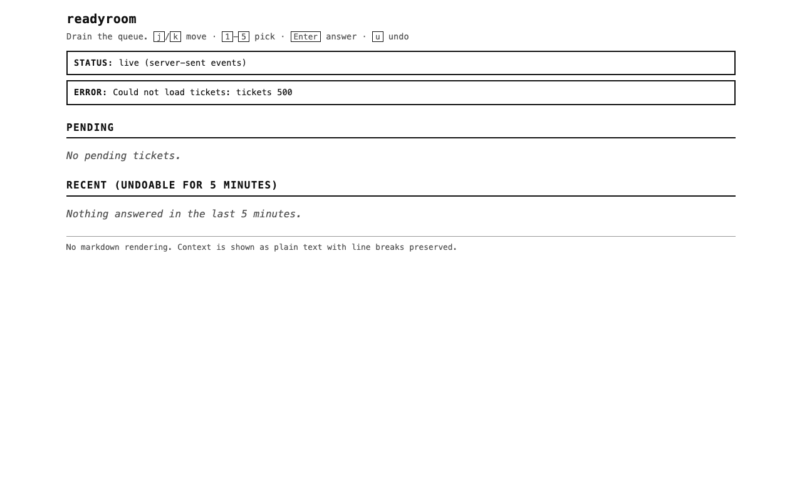

# Using the readyroom page

The readyroom page is the single-screen console where a human **drains the queue** — reads the
tickets agents have enqueued, decides, and answers. It is served by every target (npx, Docker,
Cloudflare Worker) from the same file, [`public/index.html`](../public/index.html).

This guide covers where to go and how to operate the page. For what a ticket *is* and how agents
create one, see the [README](../README.md). For the API the page talks to, see the
[route table](../README.md#http-route-table) and [`docs/SPEC.md`](SPEC.md).

- [Using the readyroom page](#using-the-readyroom-page)
  - [Open the page](#open-the-page)
  - [The token gate](#the-token-gate)
  - [Reading the board](#reading-the-board)
  - [Answering a ticket](#answering-a-ticket)
  - [Keyboard shortcuts](#keyboard-shortcuts)
  - [Urgency levels](#urgency-levels)
  - [Streams](#streams)
  - [Recent and Undo](#recent-and-undo)
  - [Live status and the polling fallback](#live-status-and-the-polling-fallback)
  - [Error states](#error-states)
    - [Token rejected (401)](#token-rejected-401)
    - [Could not load tickets](#could-not-load-tickets)
    - [Per-card errors](#per-card-errors)
    - [No JavaScript](#no-javascript)
  - [See also](#see-also)

## Open the page

Point your browser at the server's origin. The default is:

```
http://127.0.0.1:8971/
```

- **npx / local dev** — `npx readyroom`, `npm start`, or `npm run dev`, then open
  `http://127.0.0.1:8971/`.
- **Docker** — the container is published on `127.0.0.1:8971`, so the same URL works on the host.
- **Worker** — the page is served from the Worker's own origin (typically behind Cloudflare
  Access), e.g. `https://readyroom.example.com/`.
- If you changed `READYROOM_PORT` (or the Docker port mapping), substitute that port.

The page is a **status board, not a chat log**: it shows what is waiting, and a card clears once
you answer it. There is no message history and no markdown rendering — a ticket's `context` is
shown as plain text with its line breaks preserved.

## The token gate

Every `/api/*` request the page makes carries `Authorization: Bearer <token>`. On first visit the
page has no token, so it shows the **token bar** and the status line reads `waiting for token`:


1. Type the value of `READYROOM_TOKEN` into the **Access token** field.
2. Click **Save token** (or press `Enter` in the field).

The token is stored in this browser's `localStorage` under the key `readyroom_token` and attached
to every subsequent request. You enter it once per browser, not once per visit.

- **Docker and Worker** — the token is **mandatory**; a missing or wrong value is rejected. See
  [Error states](#error-states).
- **npx on loopback with no token configured** — the server itself asks for nothing, but the page
  still gates on a *non-empty* value before it starts fetching. Enter any non-empty string in that
  case.

To use a different token later, clear the field's value from browser storage (or let a `401`
re-prompt you) and save a new one.

## Reading the board

Once a token is saved, the page loads the current queue and renders two sections:

- **Pending** — tickets waiting on you, grouped by stream.
- **Recent (undoable for 5 minutes)** — tickets you (or a default) answered in the last five
  minutes.

Each pending card shows the **stream name** (which agent asked), the ticket **age** (e.g. `4m
old`), an **urgency badge**, the **question**, any **context**, and the controls to answer it:


The browser **tab title** carries the pending count — `(3) readyroom` when three tickets are
waiting, and plain `readyroom` when the queue is empty. When nothing is pending, the Pending
section reads "No pending tickets."

## Answering a ticket

A ticket offers whichever of two answer paths its author supplied; some have both.

**Option buttons.** If the ticket has options, each is rendered as a numbered button
(`1. Save`, `2. Apply`, …). Click one to choose it.

**Free text.** Every pending card has an **Answer** field and an **Answer** submit button. Type
your answer and submit it.


Answer rules:

- **Free text wins over a picked option.** If you type text *and* have an option selected, the
  typed text is submitted as the answer.
- **One of the two is required.** Submitting with neither shows an inline, per-card error —
  `Type an answer or pick an option first.` — and does not send anything.
- Submitting posts to `POST /api/answer` and the card then moves to the **Recent** section.

A confirmation banner is never shown; the card leaving Pending and appearing in Recent *is* the
confirmation.

## Keyboard shortcuts

Draining a queue with a mouse is the slow path, so the page is keyboard-first. The shortcuts are
also printed under the page title.

| Key | Action |
|---|---|
| `j` | Move the selection to the next pending ticket. |
| `k` | Move the selection to the previous pending ticket. |
| `1`–`5` | Pick option 1–5 on the selected ticket. |
| `Enter` | Submit the selected ticket's answer. |
| `u` | Undo the most recently answered ticket. |

Notes:

- **The selection affordance.** Moving with `j`/`k` marks a card as selected: it gains a **thick
  left border** and a **`SELECTED`** text marker (both, not colour alone). `1`–`5` and `Enter`
  act on that selected card. Cells wrap: selection clamps at the first and last ticket.
- **While typing, the shortcuts are off.** When the focus is inside a text field, `j`/`k`/`1`–`5`
  are typed as normal characters. `Enter` inside an Answer field submits *that card*.
- **Modifier keys are ignored** — `Ctrl`/`Cmd`/`Alt` + a shortcut does nothing special.
- **The Recent section is not a selection target.** `j`/`k`/`Enter` never act on answered cards;
  the selection marker deliberately does not appear on them.

An option button, once picked by click or by number, is shown as pressed (a double border and bold
label):


## Urgency levels

Every ticket carries one of three urgency levels, set by the agent that enqueued it. The level is
carried by the badge's **border style and text**, not just its colour, so it stays legible in
grayscale and in a forced-colors / high-contrast mode:

| Urgency | Badge | Meaning |
|---|---|---|
| `low` | Dotted border, `urgency: low` | Answer when convenient. |
| `normal` | Solid border, `urgency: normal` | The default. |
| `blocking` | Double, 4px border, `urgency: blocking` | The agent is held up on this. |

The badge text reads `urgency: low` / `urgency: normal` / `urgency: blocking`. Urgency is
informational — it does not reorder the queue, which is always grouped by stream (see below).

## Streams

A **stream** is the agent that asked. Pending tickets are grouped under a stream heading, and
groups are ordered **newest stream first** (the stream with the most recent ticket at the top).
Within a stream, the newest ticket is first. Each heading shows the stream name and how many of
its tickets are pending (`2 pending`).

This grouping is the point of the board: a flat list of questions from four agents is a pile, not
a queue. Grouping tells you at a glance which agent is waiting on you.

## Recent and Undo

Answering a ticket does not erase it immediately. Answered tickets stay in the **Recent (undoable
for 5 minutes)** section for five minutes, then drop off. An answered card has a **dashed border**,
a **`STATUS: ANSWERED`** badge, who answered it (`by human`, or `by default` when the ticket
expired and its default answer was applied), the recorded answer, and an **Undo** button:


- **Undo** (button, or press `u` for the most recent) posts to `POST /api/undo`, which returns
  the ticket to Pending.
- The five-minute window is measured from the answer's timestamp. Outside it, undo fails with
  `Undo window has passed (409).`
- When nothing has been answered recently, the section reads "Nothing answered in the last 5
  minutes."

## Live status and the polling fallback

The status banner at the top of the page reports how updates are arriving:

| Status text | What it means |
|---|---|
| `waiting for token` | No token saved yet; nothing is being fetched. |
| `idle` | A token is saved but no live connection is established yet. |
| `live (server-sent events)` | Subscribed to `/api/events`; updates arrive as they happen. |
| `polling every 5s` | The live stream is unavailable; the page re-fetches `/api/tickets` every 5 s. |

The page prefers **server-sent events**: it opens `/api/events` (with the bearer token — it reads
the stream with `fetch` rather than `EventSource`, because `EventSource` cannot attach an
`Authorization` header). If that connection fails to open, closes, or the endpoint rejects the
request, the page **falls back automatically** to polling:


This fallback is load-bearing, not a nicety: the Cloudflare Worker target returns `501` from
`/api/events`, so **polling every 5s is the Worker's normal live-update path**. No action is
needed on your part — the page switches on its own.

Text you have typed into an Answer field is preserved across these re-renders, so polling will not
interrupt your typing or lose a draft.

## Error states

Errors appear as banners and never as modals — the page does not steal focus.

### Token rejected (401)

If a request comes back `401`, the stored token is dropped, the token bar reappears, and the error
banner reads **`Token rejected (401). Enter it again.`** This means the saved value does not match
the server's `READYROOM_TOKEN` (it was rotated, or mistyped). Re-enter the correct token:


### Could not load tickets

If `GET /api/tickets` fails, the global error banner reads **`Could not load tickets: <reason>`** —
for example `Could not load tickets: tickets 500` for a server error, or `... network error` when
the server is unreachable:



The page keeps retrying (on the next SSE frame or the next poll), so this banner often clears
itself once the server recovers.

### Per-card errors

Answering failures are shown on the card itself, not globally:

| Message | Cause |
|---|---|
| `Type an answer or pick an option first.` | Submitted with empty text and no option picked. |
| `Ticket not found (404).` | The ticket no longer exists. |
| `Already answered (409).` | Someone (or an expiry default) already answered it. |
| `Answer failed (500).` / `Answer failed: <reason>` | The server or network rejected the request. |

Undo failures appear in the global banner: `Undo window has passed (409).`, `Undo failed (500).`,
or `Undo failed: <reason>`.

### No JavaScript

The page needs JavaScript to drain the queue. With scripting disabled it renders a single banner:
"Error: This page needs JavaScript to drain the queue."

## See also

- [README](../README.md) — what readyroom is, the MCP tools, and how to run each target.
- [`docs/SPEC.md`](SPEC.md) — the design spec, including the page's required behaviors.
- [`docs/screenshots/MANIFEST.md`](screenshots/MANIFEST.md) — every captured page state, one line
  each.
- Regenerate the screenshots in this guide with `npm run screenshots` from the repo root.
